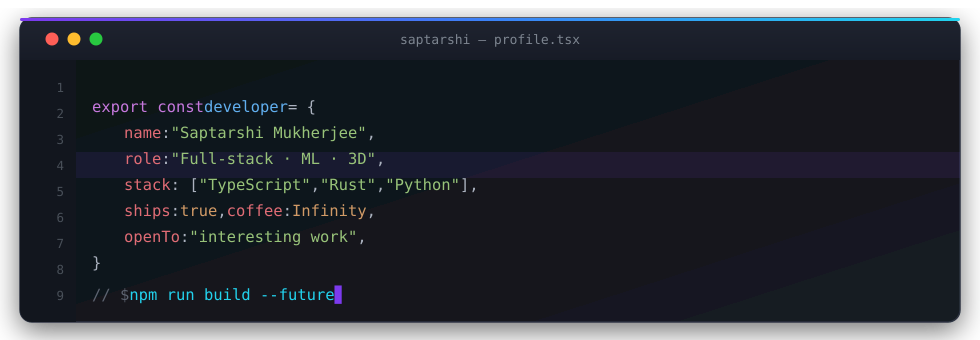

<div align="center">



<h1>Hey there, I'm Saptarshi 👋</h1>

<h4>🎓 Student developer &nbsp;·&nbsp; 🛠️ Building web apps, ML pipelines &amp; 3D experiences</h4>

[](https://www.linkedin.com/in/saptarshi-mukherjee-6a2b20280/)
[](https://saptarshi2006.github.io)
[](https://x.com/Saptarshi2006)
[](mailto:saptarshi.mukherjee.dev@gmail.com)

</div>

---

### 🚀 A little about me

I'm a student who loves turning ideas into **shipped products** — from full-stack apps and
microservice architectures to machine-learning pipelines and cinematic 3D web experiences.
I care about clean architecture, smooth interactions, and things that actually work.

```yaml
currently: Building FitMentor & exploring full-stack systems
learning:  Distributed systems, ML engineering, WebGL
fun_fact:  I ship on weekends and refactor at 2am
```

---

### 🛠️ Tech I work with

<div align="center">


</div>

---

### 💼 Things I've built

<table>
<tr>
<td width="50%">

#### 💰 Cartis
AI financial coaching — wallet & budget intelligence with a buy-or-wait verdict before every spend, plus a browser extension that watches product pages while you shop.
`Rust` `Axum` `Next.js` `PostgreSQL` · [live ↗](https://cartis.dpdns.org)

</td>
<td width="50%">

#### 🏋️ FitMentor
AI fitness coach for Indian beginners — personalized workouts, meal plans, habit tracking and a real-time AI coach streamed over WebSockets, in a PWA + Android app.
`React` `Rust` `Redis` `WebSockets` · [live ↗](https://fitmentor-7lx.pages.dev)

</td>
</tr>
<tr>
<td width="50%">

#### 🗺️ Synapse
Campus platform for Adamas University — department chat rooms, RAG-powered AI assistant, WebGL campus map with AI navigation, live bus tracking and notices.
`Next.js` `NestJS` `OpenAI` `WebGL`

</td>
<td width="50%">

#### 🌐 3D Portfolio
Scroll-driven cinematic experience — R3F scenes, custom GLSL shaders, particles, gaze-following camera and split-character type reveals.
`Next.js` `Three.js` `GSAP` · [live ↗](https://saptarshi2006.github.io)

</td>
</tr>
<tr>
<td width="50%">

#### 🔍 Fraud Detection
Production ML pipeline — XGBoost & LightGBM training with SHAP explainability and FastAPI model serving.
`Python` `Scikit-learn` `SHAP`

</td>
<td width="50%">

#### 🎂 Ankhi
A birthday site — Next.js, statically exported and deployed to Cloudflare Workers, with e2e tests.
`Next.js` `TypeScript` `Playwright`

</td>
</tr>
</table>

---

### 📊 GitHub stats

<div align="center">


<br/><br/>


<br/>


</div>

---

### 🤝 Let's connect

<div align="center">

[](https://github.com/Saptarshi2006)

<i>⚡ Always open to interesting projects, collaborations and good conversations.</i>


</div>
